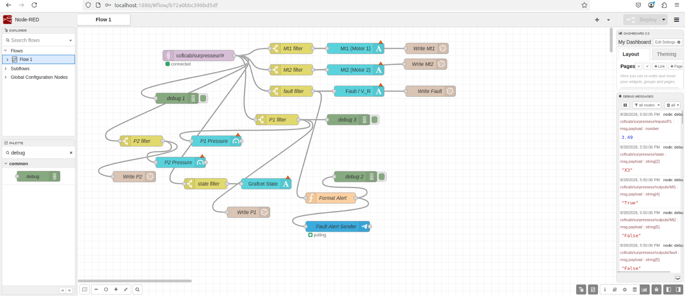
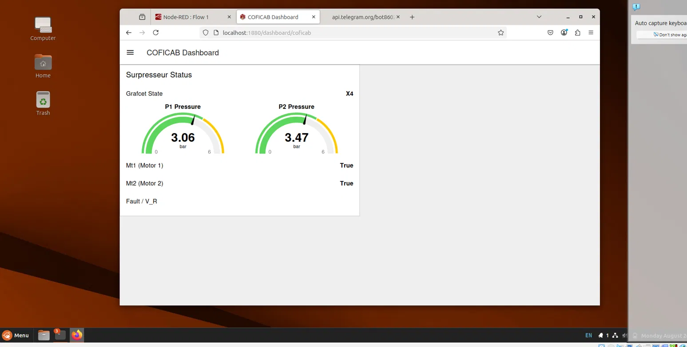
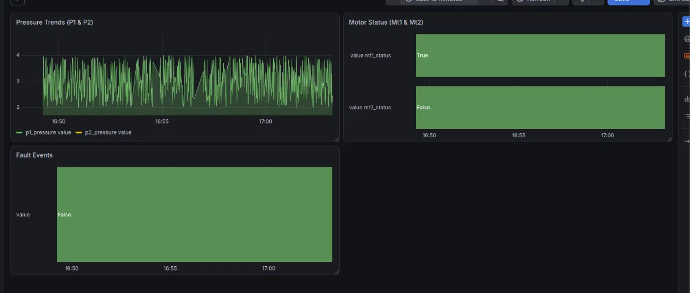
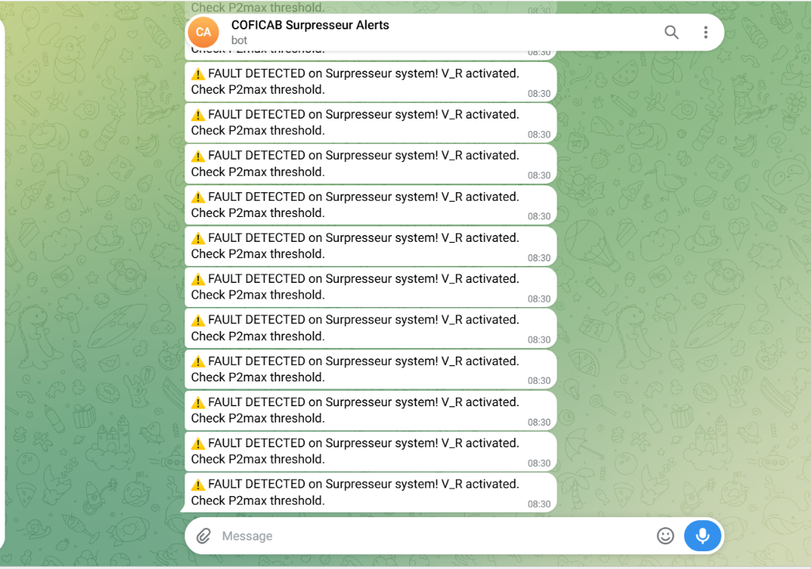

# COFICAB Surpresseur IIoT Monitoring Stack

A Dockerized Industrial IoT monitoring stack simulating a Grafcet-controlled
surpresseur (booster pump) system, with real-time dashboards and automated
fault alerting.

## Architecture

```
PLC Simulator (Python, Grafcet X0-X4)
        |
        v  MQTT (coficab/surpresseur/...)
   Mosquitto Broker
        |
        v
     Node-RED  ---------------------> Telegram Bot
   (dashboard,        (fault alerts)
    MQTT parsing,
    InfluxDB writes)
        |
        v
     InfluxDB 2.7
        |
        v
      Grafana
```

## Components

- **coficab-mosquitto** — MQTT broker handling all process topics
- **coficab-plc-simulator** — Python service simulating a Grafcet state
  machine (X0-X4), publishing sensor/actuator data to MQTT
- **coficab-nodered** — Subscribes to MQTT, drives a live dashboard,
  writes time-series data to InfluxDB, and triggers Telegram alerts on fault
- **coficab-influxdb** — Time-series storage (org: `coficab`, bucket:
  `surpresseur`)
- **coficab-grafana** — Historical trend dashboards backed by InfluxDB

## MQTT Topics

| Topic                               | Description           |
|-------------------------------------|-----------------------|
| `coficab/surpresseur/state`         | Grafcet state (X0-X4) |
| `coficab/surpresseur/outputs/Mt1`   | Motor 1 status        |
| `coficab/surpresseur/outputs/Mt2`   | Motor 2 status        |
| `coficab/surpresseur/outputs/fault` | Fault / V_R signal    |
| `coficab/surpresseur/inputs/P1`     | Pressure sensor 1     |
| `coficab/surpresseur/inputs/P2`     | Pressure sensor 2     |

## Dashboards

**Node-RED Dashboard** — `localhost:1880/dashboard/coficab`
Live gauges/text widgets for Grafcet state, P1/P2 pressure, Mt1/Mt2 status,
and fault/V_R.

**Grafana Dashboard** — `localhost:3000` → "COFICAB Surpresseur Monitoring"
Historical trend panels:
- Pressure Trends (P1 & P2) — time series
- Motor Status (Mt1 & Mt2) — state timeline
- Fault Events — state timeline

## Screenshots






## Alerting

A Telegram bot ("COFICAB Surpresseur Alerts") sends real-time fault
notifications. Node-RED filters MQTT messages on the fault topic, formats
an alert message, and sends it via the Telegram sender node.

## Running the Stack

```bash
cd ~/coficab-iiot-stack/
docker compose up -d
```

Services:
- Node-RED: http://localhost:1880
- InfluxDB: http://localhost:8086
- Grafana: http://localhost:3000 (admin/admin)

## Future Enhancements

- Grafcet state history panel in Grafana (requires adding an InfluxDB
  write node for the state topic in Node-RED)
- MQTT over TLS (encrypted broker traffic, port 8883)
- Broker authentication (currently open/unauthenticated, suitable for lab use only)
